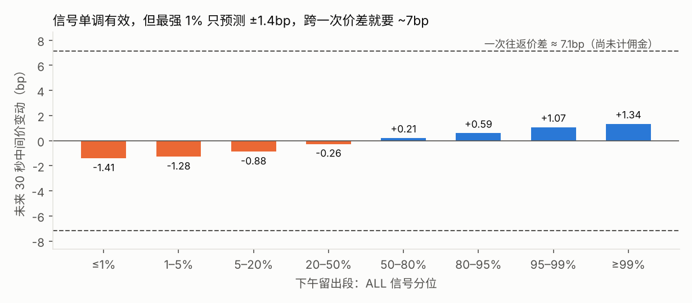

# 订单流因子与 T+1 策略

> 事前协议：[research/PROTOCOL.md](research/PROTOCOL.md)（写于计算任何 IC 之前，含事后修订记录 R1）。
> 只有一个交易日，「留出段」是同一天的下午，**不是跨日样本外**。所有结论限于 2026-09-23、上证 50。

## 一句话结论

逐笔订单流因子在下午留出段**有显著预测力**（FLOW IC = 0.099，t = 10.1，96% 股票为正），
但预注册的等权组合**没有**带来超出盘口形状的增量（配对 t = 0.16）。
信号在分位上严格单调，可最强 1% 也只预测 ±1.4bp 的 30 秒中间价变动，
而跨一次价差就要约 7bp——**这类信号不能靠主动吃单盈利**，回测扣费前就是负的。

## 1. 为什么换到订单流

参考仓库的八个因子（一档 / 五档 / 十档失衡、微价格、动量、盘口变化、价差、流动性）全部来自盘口快照，
3 秒快照就能算。逐笔数据独有的是**事件流**：谁在主动成交、大单在哪一边、撤单和新挂单落在哪里。
本研究问的是：这部分信息有没有用、有没有增量。

采样口径：1 秒网格，网格时刻 t 的盘口 = 所有 Time < t 的事件回放后的状态（无前视，见 [RECONSTRUCTION.md](RECONSTRUCTION.md) §6）。
71.1 万个网格点，0 个交叉盘、0 个单边盘。

## 2. 发现段（上午 09:31~11:29，30 秒周期）

| 因子 | 类别 | IC | t | 正 IC 股票 | 入选 |
|---|---|---:|---:|---:|:---:|
| imb1 | 盘口形状 | 0.1259 | 8.9 | 96% | 基准 |
| imb5 | 盘口形状 | 0.1224 | 10.0 | 92% | 基准 |
| micro | 盘口形状 | 0.1259 | 8.9 | 96% | 基准 |
| **tfi_10** | 主动成交失衡 | 0.0907 | 11.5 | 96% | ✓ |
| **ofi_10** | 一档订单流失衡 | 0.0733 | 8.6 | 90% | ✓ |
| **add_10** | 近端新挂单失衡 | 0.0574 | 8.3 | 88% | ✓ |
| **big_10** | 大单主动失衡 | 0.0351 | 4.8 | 76% | ✓ |
| tfi_30 / ofi_30 / add_30 / big_30 | 同上，30 秒窗口 | 0.017~0.060 | 1.8~5.3 | 52%~74% | 同族 10s 更强 |
| cxl_10 / cxl_30 | 近端撤单失衡 | −0.016 / 0.002 | −1.9 / 0.2 | 46% / 58% | ✗ 方向不符 |

入选门槛：符号符合预期、跨股票 t ≥ 3（39 次检验的噪声锚点 √(2·ln 39) ≈ 2.71）、≥ 70% 股票为正。

**副产品：micro ≡ imb1 / 2。** (微价格 − 中间价)/价差 代数上恰等于一档失衡的一半（数值最大差 7e-12）。
参考仓库的压力分数 `0.7×失衡 + 0.3×微价格` 与它穷举的 162 个组合中，含 imb1 与 micro 的组合是完全共线的。

## 3. 留出段（下午 13:01~14:55，只运行一次）

| 组合 | 10s IC | **30s IC** | 30s t | 30s 正 IC 股票 | 60s IC |
|---|---:|---:|---:|---:|---:|
| BOOK = z(imb5)+z(micro) | 0.2231 | **0.1994** | 13.3 | 100% | 0.1826 |
| FLOW = 四个入选订单流因子等权 | 0.1066 | **0.0985** | 10.1 | 96% | 0.0942 |
| ALL = 六个成分等权 | 0.2217 | **0.2008** | 16.7 | 98% | 0.1869 |

| 预注册假设 | 结果 | 判定 |
|---|---|:---:|
| H1：FLOW 在 30s 的 IC > 0，t ≥ 2 | IC 0.0985，t 10.1，30 分钟块 bootstrap 95% 区间 [0.067, 0.109] | **通过** |
| H2：ALL − BOOK > 0，配对 t ≥ 2 | +0.0014，配对 t 0.16，50% 股票改善 | **未通过** |

四个入选因子在下午全部保持正 IC（tfi 0.105、ofi 0.075、add 0.052、big 0.026），没有一个翻转。
盘口形状因子下午比上午更强（0.12 → 0.18~0.19），与参考仓库「尾盘强于开盘」的观察一致。

### H2 为什么没过（事后分析，不计入检验）

- FLOW 与 BOOK 的逐股票相关只有 **0.035**；FLOW 对 BOOK 残差化后 IC 仍为 **0.093（t ≈ 9.4）**
- 所以订单流**有**与盘口形状正交的信息，失败来自预注册的组合方式：六个成分等权，
  四个弱信号把两个强信号稀释了
- 按**上午** IC 定权重（BOOK:FLOW = 0.134:0.093）的探索组合，在下午 30s IC 为 0.214，比 BOOK 高 0.015（配对 t ≈ 2.8）。
  这是看过留出段之后才做的，**只能作为下一个交易日的预注册假设**

## 4. 快照时间错位的代价

同一组 imb1 / imb5 / micro，分别用交易所快照（标签 T）和无前视盘口计算，标签都从 T 时刻的无前视中间价起算：

| 因子 | 30s IC：快照 | 30s IC：无前视盘口 |
|---|---:|---:|
| imb1 | 0.121 | 0.152 |
| imb5 | 0.117 | 0.132 |

协议原本预期快照会让 IC **虚高**（它包含 T 之后的信息），实测反而**偏低** 8%~28%。事后分解：

| T 到 T+偏移之间中间价 | 样本占比 | IC：快照 | IC：无前视盘口 |
|---|---:|---:|---:|
| 未变 | 79% | 0.138 | 0.143 |
| 已变 | 21% | **−0.028** | 0.201 |

价格刚跳一档时，新的一档是刚形成的薄队列，失衡被「重置」，与从 T 起算的收益关系被打乱。
结论：**时间错位扭曲信号，方向不一定是虚高**——无论哪个方向，都不能把快照标签当观测时间。

## 5. 成本墙



| 信号分位 | 未来 30s 中间价变动 | 一次往返价差 | 往返费用：100 股 | 往返费用：100 万元 |
|---|---:|---:|---:|---:|
| 最弱 1% | −1.41bp | 9.7bp | 66.5bp | 11.2bp |
| 最强 1% | +1.34bp | 6.8bp | 66.5bp | 11.2bp |

信号在八个分位上严格单调，说明它是真的；但能预测的幅度只有价差的约五分之一。
100 股的往返费用高达 66.5bp，因为 **5 元最低佣金**：一手 5 元的银行股成交额约 500 元，单边佣金就是 100bp。

## 6. T+1 策略回测（下午留出段）

规则沿用参考仓库（期初 50% 持仓、期初持仓可卖、当日买入不可卖、冷却 600 秒、每股每日最多 2 次、
买按卖一、卖按买一、佣金 / 过户费 / 印花税），另加 **1 秒执行延迟**；开仓阈值取上午 ALL 分数的 1% / 99% 分位。

| 每笔股数 | 成交次数 | 买 / 卖 | 费用 | 超额收益 | 扣费前超额 |
|---:|---:|---:|---:|---:|---:|
| 100 | 86 | 46 / 40 | 493.95 元 | −711.45 元 | −217.50 元 |
| 1,000 | 23 | 13 / 10 | 147.13 元 | −312.13 元 | −165.00 元 |

**扣费前就是负的**——跨价差的成本已经超过信号能预测的幅度，与成本墙一致。

### 顺带复现并拆解参考仓库的策略

参考仓库脚本原样运行，结果完全一致（策略 −0.2041%，超额 −0.0186% = −186 元）。拆开看：
64 笔交易、每笔约 5,051 元、费用 359.48 元（占成交额 11.1bp，主要是 5 元最低佣金），
**扣费前超额为 +173 元**。不过它 47 买 17 卖、多数仓位持有到收盘按中间价估值，
这 +173 元更可能来自尾盘方向而非盘口信号本身，不宜解读为「信号有效但被费用吃掉」。

## 7. 结论边界与下一步

- 单日、单市场状态；上午 / 下午共享当天行情，日内留出 ≠ 跨日样本外
- 成本只建模了比例费用和价差，没有建模冲击成本；1 秒延迟是假设值
- 50 只股票不独立（同一市场因子），跨股票 t 偏乐观；30 分钟块 bootstrap 作为补充

**下一步**
1. 用下一个交易日检验事后假设：按上一日 IC 加权的 BOOK+FLOW 组合是否稳定优于 BOOK
2. 把信号用在**执行**而非方向交易：逐笔数据有委托编号，可以精确模拟被动挂单的排队位置与成交概率，
   检验「信号择时 + 被动挂单」能否把单边成本从约半个价差（吃单，3~5bp）降到负值（赚价差）
3. 跨日后再划分训练 / 验证 / 测试，并把相位偏移是否跨日稳定作为数据质量检查

## 复现

```bash
python scripts/build_features.py                       # 1 秒网格，约 45 秒
python scripts/factor_research.py --stage discovery    # 冻结入选名单
python scripts/factor_research.py --stage holdout      # 只运行一次（台账记次）
python scripts/factor_research.py --stage lookahead
python scripts/posthoc.py                              # 事后解释性分析
python scripts/strategy.py                             # 回测 + 成本墙
```

输出在 `outputs/research/` 与 `outputs/strategy/`；`holdout_ledger.json` 记录留出段运行次数（本仓库为 1 次）。
