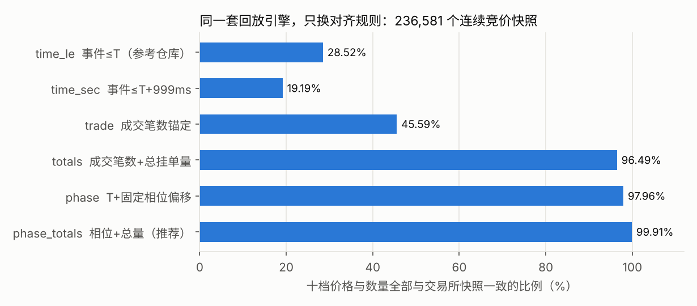

# 上交所逐笔盘口重建：对齐、订单流因子与成本墙

「量化交易系统的原理」课程作业。数据为上交所 2026-09-23 上证 50 的逐笔委托、逐笔成交与行情快照。
复用 [alittlehei/sse-orderbook-reconstruction](https://github.com/alittlehei/sse-orderbook-reconstruction)
的学习路线——**数据拆解 → 事件回放重建十档 → 与快照校验 → 盘口因子 → T+1 策略**——
但每一步都往下追了一层：为什么校验对不上、逐笔流比快照多了什么、信号够不够付成本。

> 仅用于课程学习与研究，不构成投资建议。只有一个交易日，所有结论限于该日样本。

## 三个结论

| | 发现 | 证据 |
|---|---|---|
| **1. 重建** | 参考仓库的回放规则本来就对，错在对时。每只股票的快照内容固定晚于标签时间 50~990ms；按「成交笔数 + 相位偏移 + 总挂单量」对齐后，十档全部一致率从 **28.5% → 99.9%** | [RECONSTRUCTION.md](RECONSTRUCTION.md) |
| **2. 因子** | 逐笔订单流在下午留出段有显著预测力（IC 0.099，t 10.1），但预注册的等权组合没带来超出盘口形状的增量；快照时间错位会把价格刚跳档时的信号打乱（IC 0.20 → −0.03） | [FACTOR_RESEARCH.md](FACTOR_RESEARCH.md) |
| **3. 交易** | 信号严格单调，但最强 1% 只预测 ±1.4bp，跨一次价差就要约 7bp；策略扣费前已为负。参考仓库策略的亏损主要来自 5 元最低佣金（扣费前超额 +173 元） | [FACTOR_RESEARCH.md §5–6](FACTOR_RESEARCH.md#5-成本墙) |



## 和参考仓库的关系

| 环节 | 参考仓库 | 本仓库 |
|---|---|---|
| 回放规则 | 按 (Time, BizIndex) 排序；连续竞价扣被动方、集合竞价扣双方 | **相同**（只用 BizIndex 排序，已验证等价），并加 17 项单元测试 |
| 快照对齐 | 事件 ≤ 快照 Time | 六种策略对照；推荐「成交笔数 + 相位偏移 + 总挂单量」 |
| 校验结果 | 一档价+量 37.04%（逐只**精确复现**，最大差 0.000000） | 99.96%；残差 202 个快照全部可归因 |
| 因子 | 8 个盘口形状因子，穷举 162 个组合，全日样本内 | 3 个形状 + 5 族订单流，**预注册 + 上午发现 / 下午留出（只跑一次）** |
| 策略 | 盘口压力阈值，T+1，单日回测 | 同一套账户规则 + 1 秒执行延迟 + 成本墙 + 规模敏感性 |

## 处理流程

```text
逐笔委托 ord ─┐                         ┌─ 对齐盘口（cut_points）──► 与快照逐档校验
              ├─ 按 BizIndex 回放 ─ OrderBook ─┤
逐笔成交 exe ─┘                         └─ 无前视盘口（Time < t）──► 1 秒网格 ─► 因子 ─► 策略
行情快照 snp ── MatchItem / TotalBid/AskVolume ──► 只用于对齐与校验，从不用于构造盘口
```

## 环境与运行

Python ≥ 3.10。

```bash
pip install -r requirements.txt
```

把三份原始数据放到 `raw/sse50_20260923/`，然后：

```bash
python -m pytest -q tests                              # 17 项单元测试
python scripts/reconstruct.py                          # 50 只 × 6 种对齐策略，约 2 分钟
python scripts/build_features.py                       # 1 秒网格，约 45 秒
python scripts/factor_research.py --stage discovery
python scripts/factor_research.py --stage holdout      # 留出段：只应运行一次
python scripts/factor_research.py --stage lookahead
python scripts/posthoc.py
python scripts/strategy.py
python scripts/make_charts.py
```

复现参考仓库的校验数字（需要其仓库中的 `reconstruction_validation_20260923.csv`）：

```bash
python scripts/reproduce_reference.py --reference <path>/reconstruction_validation_20260923.csv
```

## 仓库结构

```text
.
├── README.md
├── RECONSTRUCTION.md            盘口重建与对齐：证据链、六策略对照、残差归因
├── FACTOR_RESEARCH.md           订单流因子、前视检验、成本墙、T+1 回测
├── research/PROTOCOL.md         事前协议（含事后修订记录）
├── lob/                         核心库
│   ├── events.py                ord / exe 解码与合并
│   ├── book.py                  订单簿状态机（含异常计数）
│   ├── replay.py                六种对齐策略、相位偏移估计、回放
│   ├── validate.py              逐档比对
│   └── flow.py                  1 秒网格采样与订单流累计量（含逐事件 OFI）
├── scripts/                     各步骤入口
├── tests/                       单元测试（合成数据，不依赖行情）
├── docs/img/                    报告图
└── outputs/                     全部结果表（1 秒网格特征文件可再生成，不入库）
```

## 原始数据校验

原始数据不入库（`ord` 超过 GitHub 单文件 100MB；也可能受课程或供应商授权限制）。
三个文件的 SHA-256 与参考仓库公布的值**完全一致**：

| 文件 | 字节数 | SHA-256 |
|---|---:|---|
| `exe_20260923.parquet` | 78,166,158 | `EC1774C557600549992F1C349705FDACDDDEABDB58750A8FBA4D2198F9207222` |
| `ord_20260923.parquet` | 125,584,504 | `5E3FA7F96EDC130262661BF379A5C367952327D36B0936E720CBA907E78BD61B` |
| `snp_20260923.parquet` | 26,806,291 | `AC69D2F1810A24A15CB4C90183A6D3EA7EE31ECCBCD98C58ED1F7F7F7C34AA87` |

`outputs/reconstruction/reconstructed_orderbook_20260923.parquet` 是衍生数据；
发布前请确认课程与数据供应商允许公开，否则一并从仓库排除。

## 结论边界

- 一个交易日：上午 / 下午同属一天，日内留出不等于跨日样本外
- 相位偏移是对这一天数据的经验规律，是否跨日稳定需要更多交易日验证
- 回测只建模价差与比例费用，未建模冲击成本；1 秒延迟为假设值
