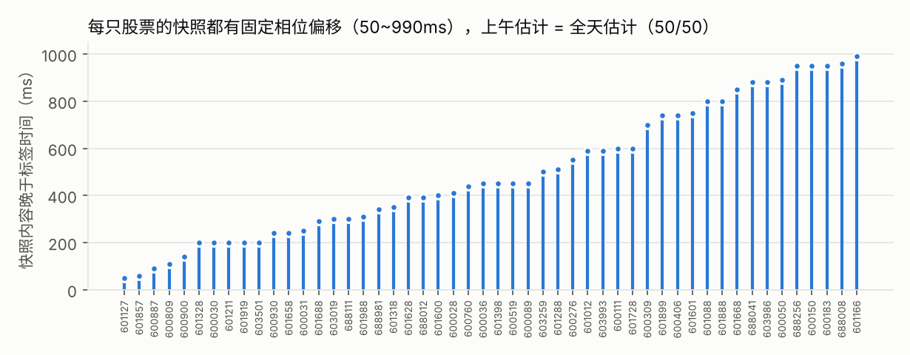

# 盘口重建：从 37% 到 99.96%

## 一句话结论

**参考仓库的回放引擎本来就是对的，错的是「和快照对时」的方式。** 交易所快照的标签时间 T
并不是它的内容时刻：每只股票的快照内容固定晚于标签 50~990ms。按「成交笔数 + 固定相位偏移 + 总挂单量」
三重对齐后，同一套回放规则在 236,581 个连续竞价快照上一档价+量吻合 **99.956%**、
十档全部完全一致 **99.915%**，最差的股票也有 99.1%。


## 1. 问题从哪里来

参考仓库（[alittlehei/sse-orderbook-reconstruction](https://github.com/alittlehei/sse-orderbook-reconstruction)）
用「事件 Time ≤ 快照 Time」决定每个快照前应用哪些事件，一档价+量吻合率 37.04%，
600183 只有 2.5%。它在 README 里推测原因是「快照时间戳不能表示同一时间批次内的精确事件边界」。

这个推测方向是对的，但可以被精确量化。快照里有三组参考仓库没用到的字段：

| 字段 | 含义 | 用途 |
|---|---|---|
| `MatchItem` | 当日累计成交笔数 | 精确定位快照落在第几笔成交之后 |
| `AccVolume` | 当日累计成交量 | 交叉核对 MatchItem |
| `TotalBidVolume` / `TotalAskVolume` | 全部买 / 卖挂单总量 | 在两笔成交之间进一步定位切点 |

## 2. 证据链

**第 1 步：成交笔数是精确的锚。** 把成交流按 BizIndex 排序，取第 `MatchItem` 笔，
其累计量与快照 `AccVolume` 在 **242,873 / 242,873** 个有成交的快照上全部相等。
在 236,581 个连续竞价快照里，**42.5% 包含了时间戳晚于 T 的成交**（最多晚 990ms），
「事件 ≤ T」必然漏掉它们。

**第 2 步：每只股票有固定相位偏移。** 在「总挂单量只在缺口内一个位置吻合」的快照上，
每个快照给出约束「第 c−1 个事件时间 ≤ T + 偏移 ≤ 第 c 个事件时间」。
对每只股票扫描 0~2990ms（10ms 步长），满足约束最多的偏移即估计值：



- 50 只股票的偏移分布在 50~990ms，中位数 450ms
- 49 只的约束满足率为 **100%**——全天所有无歧义快照都被同一个常数解释
- **只用上午数据估计的偏移与全天估计完全相同（50/50）**；用上午偏移重建下午，十档全对 99.92%
- 例外：601166 偏移 990ms、满足率 81.8%，各半小时段都稳定在 990ms 而非漂移。
  偏移恰好压在整秒边界附近，10ms 精度的时间戳会在两个秒标签之间抖动——**这是假设，未验证**

**第 3 步：同一标签时间的不同股票并不同步。** 曾假设交易所在同一时刻为所有股票拍快照
（BizIndex 是全局编号，若成立可跨股票交叉约束）。检验结果：同一 T 下各股票的可行全局切点区间
交集**为空的比例是 100%**。快照是逐股异步生成的——这个负结果直接导向了「逐股估计偏移」。

## 3. 六种对齐策略

同一个 `OrderBook`，只在 `lob/replay.py::cut_points` 里换规则。

| 策略 | 规则 | 一档价+量 | 十档全部一致 | 最差个股 |
|---|---|---:|---:|---:|
| time_le | 事件 ≤ T（参考仓库） | 37.45% | 28.52% | 0.19% |
| time_sec | 事件 ≤ T+999ms（以为是秒级截断） | 27.13% | 19.19% | 0.95% |
| trade | 夹在第 MatchItem 与第 MatchItem+1 笔成交之间 | 58.97% | 45.59% | 26.01% |
| totals | 上一行缺口内，取总挂单量吻合的切点 | 98.47% | 96.49% | 63.10% |
| phase | 事件 < T + 该股偏移（只用时间） | 98.87% | 97.96% | 86.03% |
| **phase_totals** | totals 的候选里取最接近 phase 的 | **99.96%** | **99.92%** | **99.14%** |

校验窗口：09:30:00~11:30:00、13:00:00~14:57:00（之后是收盘集合竞价，快照显示虚拟撮合价，不可比）。

两个值得注意的点：
- **time_sec 比 time_le 更差。** 「快照是秒级截断」这个直觉是错的：偏移在 50~990ms 之间各不相同，
  一律加 999ms 对偏移小的股票过头了
- **totals 单独用时最差个股只有 63%**：缺口内若有「撤一笔、挂一笔、量相同」，总量在两个位置都吻合，
  需要相位偏移来消歧

## 4. 剩余 0.085% 的误差在哪里

推荐策略下仍有 202 个快照不完全一致，**全部**属于同一类：

| 原因 | 快照数 |
|---|---:|
| 总量在缺口内多处吻合，选错了切点 | 202 |
| 总量在缺口内无处吻合（引擎状态与交易所不一致） | **0** |
| 切点唯一但档位仍不一致 | **0** |

另外全天 0 次异常扣减（撤单 / 成交找不到原委托、扣减超量）。
**凡是切点唯一确定的快照，十档 100% 一致**——可以把回放引擎视为精确的。

## 5. 复现参考仓库

`scripts/reproduce_reference.py` 用参考仓库的校验口径（含收盘集合竞价、两端闭区间）跑 time_le，
与它公布的 `reconstruction_validation_20260923.csv` 逐只比对：

- 50/50 只股票的检查快照数一致
- 一档价+量吻合率：0.3704 vs 0.3704，**逐只最大差 0.000000**
- 一档价格吻合率：0.8528 vs 0.8528，逐只最大差 0.000000

所以上表的提升完全来自对齐规则，不是实现差异。

## 6. 这对研究意味着什么（最重要的一节）

快照标签 T 的内容是 T+偏移那一刻的状态。于是：

- **做交易研究时，参考仓库的「事件 ≤ T」盘口才是 T 时刻真正能看到的状态。**
  它和快照「对不上」，是因为快照来自 T 之后 0.05~0.99 秒，不是因为重建错了
- **反过来，直接拿交易所快照的 Time 当观测时间，会和逐笔流错位。**
  因子研究里的实测（见 [FACTOR_RESEARCH.md](FACTOR_RESEARCH.md) §4）：错位不是单向让 IC 虚高，
  而是在价格刚跳档的 21% 样本里把信号打乱（IC 从 0.20 变成 −0.03）

因此本仓库：**校验用对齐盘口，研究与回测一律用「Time < t」的无前视盘口。**

## 7. 实现要点

- 排序键只用 `BizIndex`：委托与成交两表全局唯一、严格递增（0 重复），且 Time 随 BizIndex 单调不减（50/50 只）
- 委托以 `OrderOriNo` 为键；上交所委托流只出现「进入盘口的剩余量」，即时全部成交的主动单不会出现 ADD
- 连续竞价成交只扣被动方；集合竞价成交（BSFlag=0）两边都扣
- 15:00 之后的成交是科创板盘后固定价格交易，不进入连续竞价盘口
- 「对齐」与「回放」分离：`cut_points()` 只决定切点，`replay()` 只回放，两遍扫描（第一遍记录总量路径）
- 50 只 × 6 策略全量跑完约 2 分钟（2 核）

## 复现

```bash
python scripts/reconstruct.py                 # 输出到 outputs/reconstruction/
python scripts/reproduce_reference.py --reference <参考仓库>/reconstruction_validation_20260923.csv
```

| 输出 | 内容 |
|---|---|
| `validation_summary.csv` | 六种策略的全样本汇总 |
| `validation_by_symbol.csv` | 50 只 × 6 策略 |
| `offsets.csv` | 每只股票偏移（全天 / 仅上午）与一致率 |
| `residuals.csv` | 202 个残差快照及归因 |
| `reference_reproduction.csv` | 与参考仓库逐只对照 |
| `reconstructed_orderbook_20260923.parquet` | 推荐策略的十档盘口，含逐快照吻合标记 |
